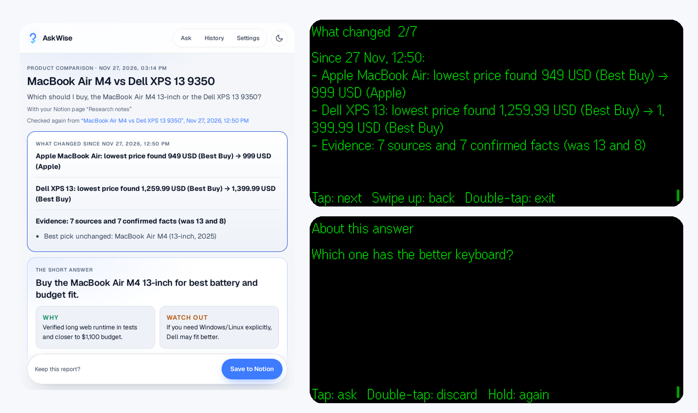
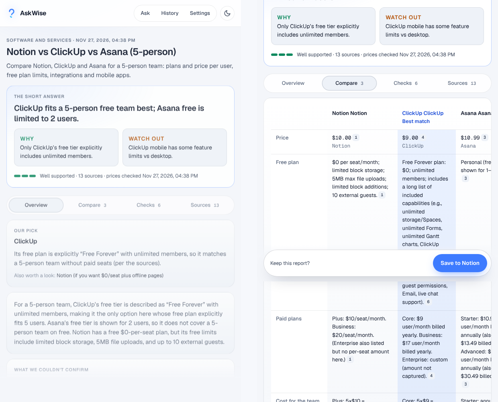

<div align="center">


# AskWise

**Know what to choose.**
A research assistant for Even Realities G2 glasses.

[](https://askwise.up.railway.app)
[](media/askwise-demo.mp4)

[What it does](#what-askwise-does) · [Use it](#use-askwise-in-two-minutes) · [Notion](#notion) · [Privacy](#privacy) · [Run it yourself](#run-it-yourself)


</div>

## What AskWise does

When you're deciding between a few things to buy, the facts are spread across a dozen tabs and they often disagree. In our own test, Tom's Hardware measured the Dell XPS 13 at 17 h 29 m with one screen and 8 h 40 m with the other, while Dell's page says up to 26 hours.

AskWise does that reading for you. You ask a question, it searches official pages, reviews and shops, checks each important fact against the page it came from, and puts a short answer on your glasses: the best pick, why, and what to watch out for. The full report, with every source, opens on your phone.

It works for products, for software and online services, and for general questions.

## Use AskWise in two minutes

You don't need an account, and you don't need to connect anything.

1. Open **[askwise.up.railway.app](https://askwise.up.railway.app)** on your phone or computer.
2. Type what you're deciding, for example: *Which should I buy, the MacBook Air M4 or the Dell XPS 13? My budget is $1,100.*
3. Tap **Research**. In about a minute the answer is ready.
4. Open the report to see the comparison, the checked facts and every source.

Each device gets its own private space automatically.

### On the G2 glasses

Open AskWise from the Even Realities app on a phone paired with your G2. To load it, scan the code from `npx @evenrealities/evenhub-cli qr --url https://askwise.up.railway.app`.

| On the glasses | What it does |
|---|---|
| Hold the touchpad and speak | Asks a question by voice. It appears as a draft, and nothing happens until you tap |
| Tap | Next screen, or send a draft |
| Swipe up | Back |
| Double-tap | Throw away a draft, or leave the app |

The answer comes in short screens: **Answer**, **Why**, **Watch out**, **Evidence** (sources, confirmed facts and when prices were checked), **More options** and **Save**.

### Check again, and ask more



- **Check again** researches the same question fresh and shows what changed since last time: the pick, each price with its shop, and any specification whose numbers really changed. Every change is read from the two real reports.
- **Ask more** lets you ask a follow-up about a finished report. Type it under the report, or hold the touchpad and ask while the answer is on your lens. AskWise keeps the earlier answer in mind.

### Software and services too

Ask it to compare apps or online services and it lines them up side by side: each plan and its price per user, the free plan and its limits, mobile apps, offline use and integrations, taken from the vendors' own pages.



## How AskWise labels what it found

Every fact carries a label and numbered links to its sources.

| Label | Meaning |
|---|---|
| Confirmed | A reliable source supports it |
| Backed by several sources | More than one independent source supports it |
| Sources disagree | Reliable sources say different things, and the report shows both |
| Not confirmed yet | There isn't enough evidence |
| May be out of date | The information is old |
| Our conclusion | AskWise worked this out from the facts it found |

A price is shown only when a real shop page has it, with the amount, currency, country, shop and the time it was checked. Otherwise the report says: *Check the shop for today's price.*

## Notion

Notion is optional. Without it you can still save any report to our public [AskWise shared reports](https://smooth-town-628.notion.site/AskWise-shared-reports-424669a3d1fd811fad46f66d0c26cfd6) page, which anyone can open without a Notion account. The save screen tells you it's public before anything is written.

To use your own Notion:

1. In AskWise, open **Settings** and tap **Connect Notion**.
2. Notion asks which pages AskWise may use. Tick the pages you want and tap **Allow access**.
3. Back in AskWise, choose the page it should read and the page where saved reports go.
4. When you ask a question, tick **Use "your page"** under the question box.

There's nothing to set up in Notion first. If you want AskWise to know your budget, your country or what matters to you, write it on any page and choose that page. In our test the question never mentioned a budget, and the answer still said "around $1,100", because AskWise read it from the notes.

AskWise saves a report only after you've seen exactly what will be written and approved it. Approving twice still gives you one page. You can disconnect at any time in Settings.

## Privacy

- No account or personal details are needed.
- Your question is sent for research only when you press Research or tap a voice draft.
- The microphone listens only while you hold the touchpad. Recordings become text and aren't kept.
- AskWise reads only the Notion page you choose, and your Notion access is stored encrypted.
- Nothing goes to Notion until you approve it.
- Each device's research is private to that device, and you can delete everything from Settings.
- AskWise doesn't buy anything, send messages or change your accounts.

## Built with

| Part | Built with |
|---|---|
| Glasses app | [Even Hub SDK](https://github.com/even-realities/evenhub-templates) and [`@evenrealities/pretext`](https://www.npmjs.com/package/@evenrealities/pretext) |
| Research | OpenAI Responses API with live web search |
| Notes and saved reports | Notion API, with a sign-in for each person's own workspace |
| Voice | OpenAI speech to text |
| Phone pages and service | TypeScript, [Vite](https://vite.dev), [Hono](https://hono.dev) and Postgres |

## Run it yourself

<details>
<summary><strong>Set up and run AskWise locally</strong></summary>

You need Node.js 22.13 or newer.

```bash
npm install
cp .env.example .env      # then fill in the values below
npm run build
npm start                 # the app and the service on http://localhost:8787
```

Open http://localhost:8787 and ask a question.

| Variable | What it's for |
|---|---|
| `OPENAI_API_KEY` | Research with OpenAI web search, and voice |
| `NOTION_TOKEN` | AskWise's own Notion connection, for the shared page |
| `NOTION_SHARED_PAGE_ID`, `NOTION_SHARED_PAGE_URL` | The public page anyone can save to, and its link |
| `NOTION_OAUTH_CLIENT_ID`, `NOTION_OAUTH_CLIENT_SECRET` | The "Connect Notion" sign-in |
| `NOTION_OAUTH_REDIRECT_URI` | `https://<your-address>/api/integrations/notion/callback` |
| `ASKWISE_SECRET` | Key that encrypts stored Notion access |
| `DATABASE_URL` | Postgres address (without it, AskWise uses a local SQLite file) |
| `ASKWISE_RESEARCH_PER_HOUR`, `ASKWISE_RESEARCH_PER_DAY` | Fair-use limits: 10 per device each hour and 150 a day by default |

</details>

<details>
<summary><strong>Set up Notion for your own copy</strong></summary>

1. In Notion's developer settings, create a connection with an API token, give it **Read content** and **Insert content**, and put its token in `NOTION_TOKEN`.
2. Create a page for shared reports, add the connection to it (**⋯ → Connections**), publish it (**Share → Publish**), and set `NOTION_SHARED_PAGE_ID` and `NOTION_SHARED_PAGE_URL`.
3. For "Connect Notion", create a second connection with **OAuth**, the same capabilities and the redirect address above, then put its client ID and secret in the environment.

</details>

<details>
<summary><strong>Glasses, simulator and packaging</strong></summary>

```bash
npx evenhub qr --url http://<your-computer-ip>:8787      # open it on G2
npx evenhub-simulator http://localhost:8787              # the official simulator
npm run pack                                             # package for Even Hub
```

</details>

<details>
<summary><strong>Tests</strong></summary>

```bash
npm test
```

The tests cover the source rules (no invented sources, prices or specifications), the labels, research progress, stopped and repeated requests, follow-ups, Check again, privacy between people, Notion access, approval before saving, duplicate protection and the wording people see. Set `TEST_DATABASE_URL` to also run them against Postgres. The scripts in `scripts/` drive the full flow and voice questions in the official simulator.

</details>

## Project history

AskWise started on November 23, 2026, and everything in this repository was written from that date. It builds on the open-source projects listed under [Built with](#built-with), plus [TypeScript](https://www.typescriptlang.org), [Vitest](https://vitest.dev), [tsx](https://tsx.is) and the Geist typefaces.

Made by [datwebguy](https://github.com/Datwebguy).
