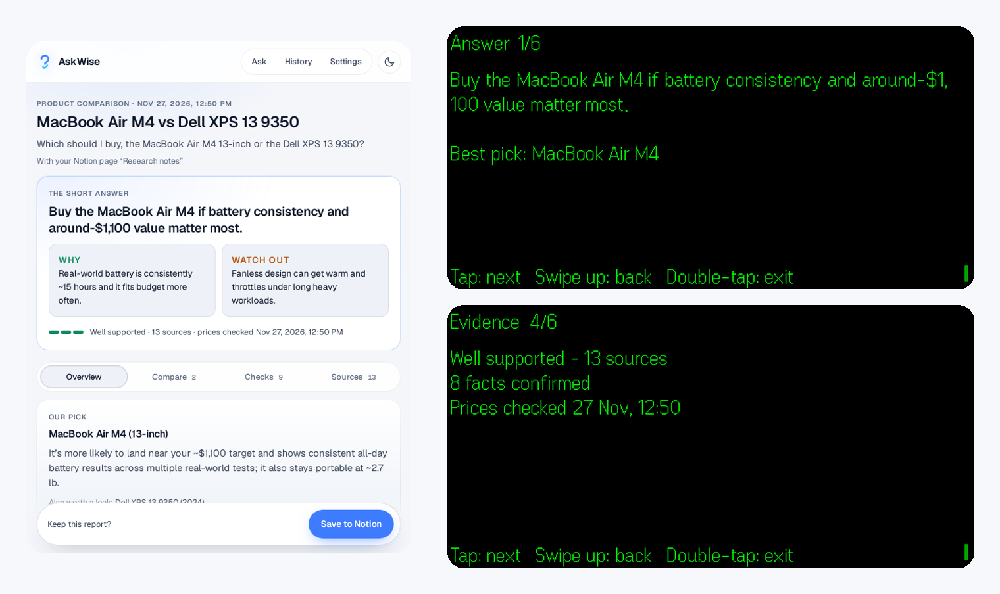
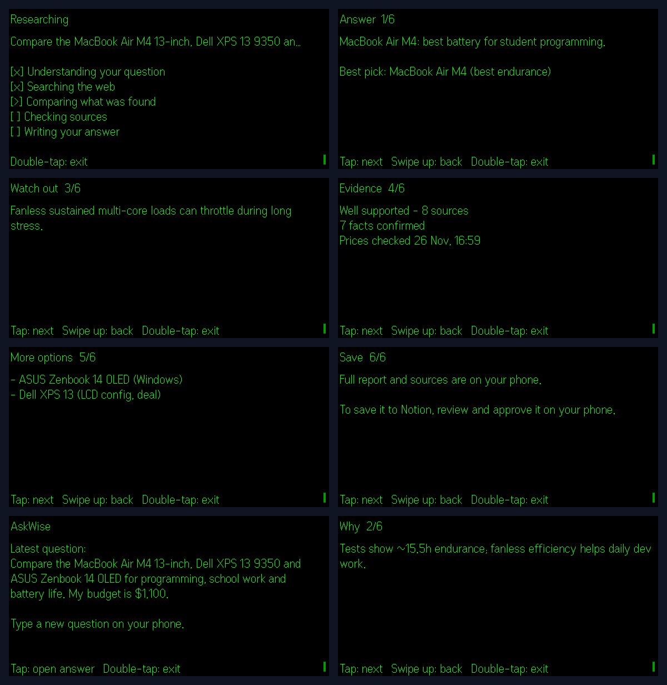
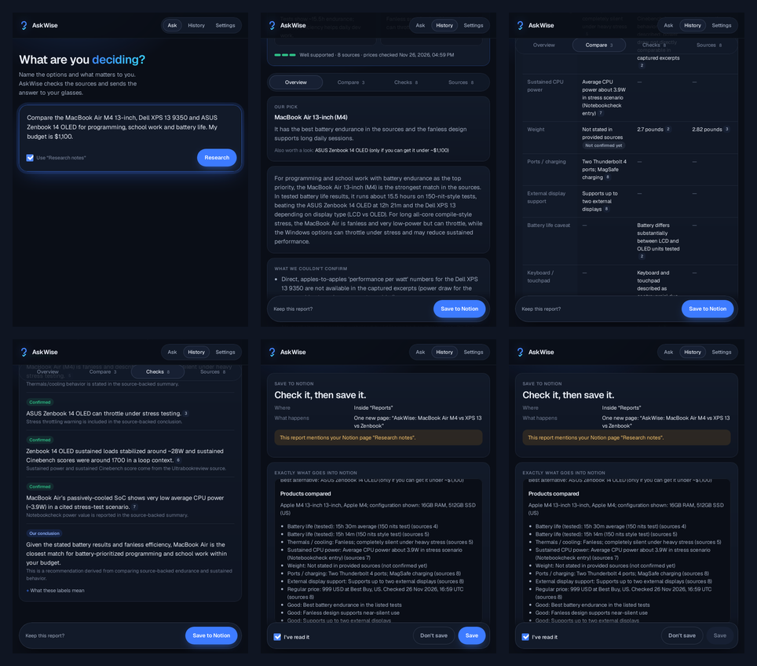

<p align="center"></p>

<h1 align="center">AskWise</h1>

<p align="center"><strong>Research anything. Compare your options. Know what to choose.</strong><br>
A research and decision assistant for Even Realities G2 glasses.</p>

<p align="center"></p>

## The problem

You want to buy a laptop. There are three good options. One site lists different specs from another, prices change from shop to shop, and reviews disagree. An hour later you have twenty tabs open and still no answer.

AskWise does that work for you. You ask once. It reads the web, checks what it finds against the sources and gives you a straight answer, with the evidence a tap away.

## Who it is for

People who make decisions on the move: shoppers comparing products, students choosing tools, professionals picking software, and anyone who wants a quick, trustworthy answer without opening a dozen websites.

## How it works

Open AskWise and start. There is nothing to sign up for and nothing to paste: each device gets its own private space automatically.

1. **Ask** on your phone: name your options and what matters to you.
2. **AskWise researches.** It searches the web, reads official pages, reviews and shops, and compares what it finds.
3. **It checks.** Every important fact is matched to the page it came from. Facts without a source are never shown as confirmed.
4. **Your glasses show the answer**: the best pick, the reason, the main drawback, how strong the evidence is and when prices were checked.
5. **Your phone shows the full report**: a comparison table, specs, prices, reviews, checked facts, disagreements and every source.
6. **You decide whether to save it.** You see exactly what will go into Notion, and nothing is written until you approve.

## What appears on the glasses

Short screens built for a 576 × 288 display. Tap to move forward, swipe up to go back, double-tap to exit.

| Screen | What it shows |
|---|---|
| Researching | The real step AskWise is on, as it happens |
| Answer | One plain sentence and the best pick |
| Why | The main reason |
| Watch out | The biggest drawback |
| Evidence | How well supported the answer is, how many sources, when prices were checked |
| More options | Alternatives worth a look |
| Save | A reminder to review and approve on the phone |

<p align="center"></p>

## What appears on the phone

The full report on one screen: the short answer first, then **Overview**, **Compare**, **Checks** and **Sources** tabs. Every fact carries small numbered links to the pages it came from.

<p align="center"></p>

### How AskWise labels information

| Label | Meaning |
|---|---|
| Confirmed | A reliable source supports this |
| Backed by several sources | More than one independent source supports this |
| Sources disagree | Reliable sources say different things |
| Not confirmed yet | There is not enough evidence |
| May be out of date | The information is old |
| Our conclusion | AskWise worked this out from the facts it found |

### Prices

Each price shows the amount, currency, country, shop, type (regular, sale, used or estimate), its source and the time it was checked. If AskWise cannot confirm a price from a real page, it says: *Check the shop for today's price.*

## Examples

**Product comparison**
> Compare the MacBook Air M4 13-inch, Dell XPS 13 9350 and ASUS Zenbook 14 OLED for programming, school work and battery life. My budget is $1,100.

AskWise identifies the exact models and variants, compares specs side by side, finds shop prices with the time checked, flags anything over budget and recommends the best match with its main drawback.

**General research**
> Explain the current state of passkeys for everyday users.

AskWise gives a short explanation, the key facts with their sources, where sources disagree and what is still unclear.

## Notion

AskWise connects to Notion so your research lives where your work does.

- **Connect in one tap.** "Connect Notion" opens Notion's own sign-in, where you pick the pages AskWise may use. Nothing to copy or paste.
- **Read a page you choose.** For example, a page with your budget, your country and the features you care about. AskWise reads only that page, and treats it as information, never as instructions.
- **Save reports you approve.** You see the destination and the exact content first. AskWise creates one new page only after you tick "I've read it" and press Save. Saving again never makes a copy.
- **Or share without connecting.** Anyone can save a report to the public *AskWise shared reports* page. The preview says clearly that anyone with the link can read it.
- **You stay in control.** AskWise only sees pages you choose in Notion, your Notion access is stored encrypted, and you can disconnect at any time.

## Why glasses

The answer you need is short: which one, why, and what to watch out for. On G2 it sits in your line of sight while you are in a shop, in a meeting or on the move. The phone holds the detail for when you want to dig in.

## How it is built

```
G2 glasses  ─┐                                  ┌─ OpenAI (web search)
             ├─ AskWise web app ── AskWise service ┤
Phone page  ─┘   (Even Hub SDK)     (Node, SQLite) └─ Notion
```

| Part | What it does | Where |
|---|---|---|
| Glasses screens | Short screens, gestures, live progress | `web/src/glasses` |
| Phone pages | Ask, report, save approval, history, settings | `web/src/phone` |
| Research engine | Plan, search, structure, check, write | `server/research` |
| Checking step | Enforces the source rules on every report | `server/research/verify.ts` |
| Notion | Connection, page reading, approved saving | `server/notion` |
| Shared wording | Every label and message people see | `shared/labels.ts` |

**Research steps.** AskWise plans the question, searches the web with OpenAI's web search tool, turns the findings into a structured report under a strict format, then checks it: any source the search did not actually return is removed, unsupported facts become "Not confirmed yet", and prices without a real shop page are removed. Research runs on the service, so it keeps going if the glasses app is closed, and the glasses pick it up again when reopened.

**Saving safely.** Each save preview has a fingerprint of its exact content and destination. Approval only goes through if the content and destination are unchanged, and a repeated approval returns the page that already exists.

## Privacy and security

- No account or personal details are needed. Each device has its own private space.
- Your questions are sent for research only when you press Research.
- Notion pages are read only if you choose one, and only that page.
- Nothing is saved to Notion until you approve the exact content.
- API keys live only on the AskWise service. The glasses and phone never see them.
- Each person's research is private to their account.
- Activity records never contain keys, report text or page content.
- You can delete everything AskWise holds about you from Settings.
- Fair-use limits keep the service available for everyone: a few questions per device each hour, and a daily total.

AskWise does not buy anything, send messages or change accounts.

## Setup

Requirements: Node.js 22.13 or newer.

```bash
npm install
cp .env.example .env      # then fill in the values below
npm run build
npm start                 # serves the app and the service on http://localhost:8787
```

Open http://localhost:8787 and ask. To use the service's own Notion connection from your device, run `npm run invite -- --owner` and open the address it prints.

### Environment variables

| Name | Purpose |
|---|---|
| `OPENAI_API_KEY` | Research with OpenAI web search |
| `NOTION_TOKEN` | The service's Notion connection, used for the shared page and the owner's pages |
| `NOTION_SHARED_PAGE_ID` | Notion page anyone can save reports to |
| `NOTION_SHARED_PAGE_URL` | Public link to that page (Notion: Share → Publish) |
| `NOTION_OAUTH_CLIENT_ID` | Public Notion connection, for "Connect Notion" |
| `NOTION_OAUTH_CLIENT_SECRET` | Its secret |
| `NOTION_OAUTH_REDIRECT_URI` | `https://<your-address>/api/integrations/notion/callback` |
| `ASKWISE_SECRET` | Key for encrypting stored Notion access (created automatically if not set) |
| `ASKWISE_RESEARCH_PER_HOUR` | Questions per device per hour (default 10) |
| `ASKWISE_RESEARCH_PER_DAY` | Questions per day in total (default 150) |
| `PORT` | Port for the app (default 8787) |
| `ASKWISE_RESEARCH_MODEL` | Model for search and reports (default `gpt-5.4-nano`) |
| `ASKWISE_PLANNER_MODEL` | Model for planning (default `gpt-5.4-nano`) |
| `ASKWISE_DATA_DIR` | Where AskWise keeps its database (default `./data`) |

Behind an HTTPS proxy, start the service with `NODE_USE_ENV_PROXY=1`.

### Set up Notion

**Shared page (for everyone):**
1. In Notion's developer settings, create a connection with an API token. Give it **Read content** and **Insert content** only, and **No user information**. Put its token in `NOTION_TOKEN`.
2. Create a page for shared reports, add your connection to it (**⋯ → Connections**), and publish it (**Share → Publish**). Put its ID and public link in `NOTION_SHARED_PAGE_ID` and `NOTION_SHARED_PAGE_URL`.

**Connect Notion (each person's own workspace):**
1. Create a second connection with **OAuth** as the authentication method and the same capabilities.
2. Set its redirect address to `https://<your-address>/api/integrations/notion/callback`.
3. Put its client ID and secret in `NOTION_OAUTH_CLIENT_ID` and `NOTION_OAUTH_CLIENT_SECRET`, and the redirect address in `NOTION_OAUTH_REDIRECT_URI`.

### Run on the glasses

```bash
npm start
npx evenhub qr --url http://<your-computer-ip>:8787
```

Scan the code with the Even Realities app on a phone paired with your G2.

### Run in the simulator

```bash
npm start
npx evenhub-simulator http://localhost:8787
```

The simulator shows the phone page and the glasses display side by side.

### Package for Even Hub

```bash
npm run pack
```

## Tests

```bash
npm test
```

The tests cover the source rules (no invented sources, prices or specs), the label rules, research progress, repeated and stopped requests, the time limit, follow-up questions, privacy between accounts, Notion page access, save approval, duplicate prevention, revoked access, key handling and the wording people see. `scripts/simulator-run.mjs` and `scripts/simulator-checks.mjs` drive the full flow and the harder moments in the official simulator.

## Demo

[Watch the demo](media/askwise-demo.mp4): a real question typed on the phone, live research, the answer on the glasses, the full report and an approved save to Notion.

## Project history

AskWise started on November 23, 2026. Everything in this repository was written from that date. It builds on these open-source projects and tools:

- [Even Hub SDK, CLI, simulator and templates](https://github.com/even-realities/evenhub-templates) by Even Realities
- [`@evenrealities/pretext`](https://www.npmjs.com/package/@evenrealities/pretext) for text measuring on the glasses
- [Hono](https://hono.dev) and `@hono/node-server`
- [Vite](https://vite.dev), [TypeScript](https://www.typescriptlang.org), [Vitest](https://vitest.dev), [tsx](https://tsx.is)
- [Geist and Geist Mono](https://vercel.com/font) typefaces via Fontsource
- Node.js built-in SQLite
- OpenAI Responses API with web search, and the Notion API

## Team

Built by [datwebguy](https://github.com/Datwebguy).
